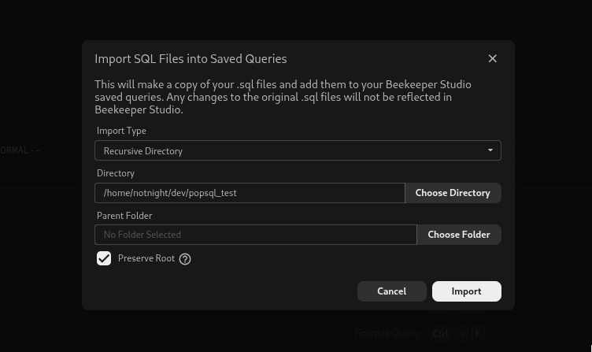

## Export queries from PopSQL

PopSQL offers a [GitHub two way sync](https://docs.popsql.com/docs/github) that will sync your queries to a repository.

1. Create a new GitHub repo
2. Go to your PopSQL settings and connect your GitHub repository
3. PopSQL will sync your queries as .sql files and preserve your directory structure
4. Clone the repository to your machine.

## Import queries into Beekeeper Studio

1. In Beekeeper, connect to any connection in the workspace you would like your queries to reside (your local workspace is only accessible to you, you can also import to a [Team Workspace](../user_guide/cloud-storage-team-workspaces.md) to share with your coworkers)
2. Go to `File > Import Saved Queries` to open the import modal
3. Select the `Recursive Directory` import type
4. Select the directory of your cloned repository that we set up above
5. Configure the Parent folder and whether or not you would like to keep the root directory
6. Import!

## Connections

PopSQL does not currently have the ability to export connections. You will have to manually transfer over your connection details.
