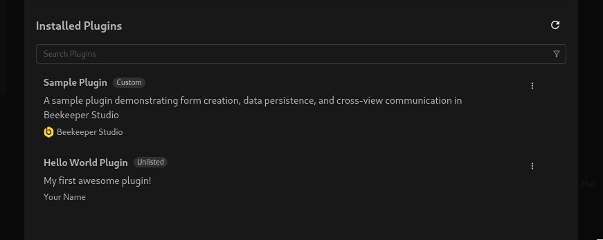
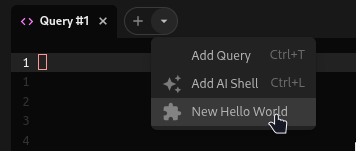
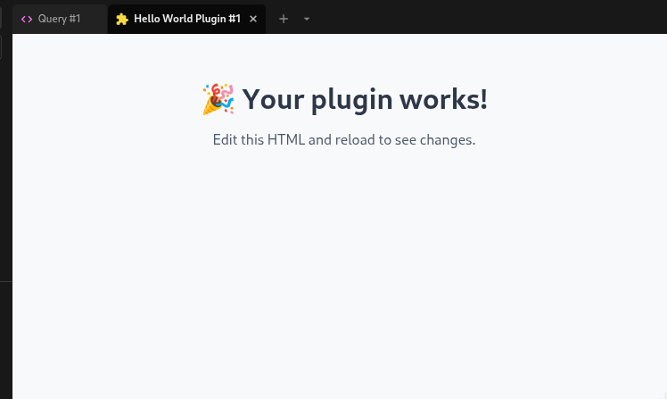
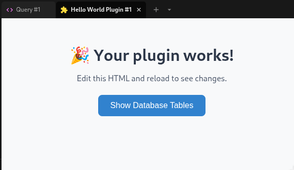
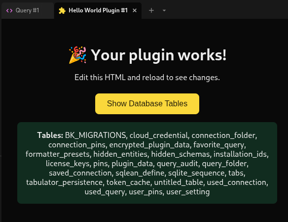

# Creating Your First Plugin

Let's build a simple "Hello World" plugin! You'll create a new tab that shows "Hello World!" and learn how to interact with databases.

## What You Need

-   Basic HTML, CSS, and JavaScript knowledge
-   Node.js and npm/yarn installed
-   Beekeeper Studio installed
-   **[The plugin system and unlisted plugins enabled](#install-your-plugin)**
-   (Optional) Use the [sample plugin](https://github.com/beekeeper-studio/bks-sample-plugin) for reference

## Quick Start (2 Options)

### Option 1: Vite Project ⭐

!!! note "Why Vite?"
    Vite provides Hot Module Replacement (HMR) for a nice development experience. When you make changes to your plugin, you'll see updates reflected in Beekeeper Studio without needing to manually reload the plugin or restart the application. This helps streamline the development process.

It's quite straightforward to configure your project using vite. With a simple `vite.config.ts` and our vite plugin, you get asset bundling and production builds.

1. Create a Vite project

    === "npm"
        ```bash
        npm create vite@latest hello-world-plugin
        cd hello-world-plugin
        ```

    === "yarn"
        ```bash
        yarn create vite hello-world-plugin
        cd hello-world-plugin
        ```

2. Install the Beekeeper Studio [Vite build plugin](sdk.md#vite-build-plugin)

    === "npm"
        ```bash
        npm install @beekeeperstudio/vite-plugin
        ```

    === "yarn"
        ```bash
        yarn add @beekeeperstudio/vite-plugin
        ```

3. Create the manifest file

    Create `manifest.json` to define your plugin:

    ```json
    {
        "id": "hello-world-plugin",
        "name": "Hello World Plugin",
        "author": {
            "name": "Your Name",
            "url": "https://yourwebsite.com"
        },
        "description": "My first awesome plugin!",
        "version": "1.0.0",
        "icon": "extension",
        "manifestVersion": 1,
        "capabilities": {
            "views": [
                {
                    "id": "hello-world-view",
                    "name": "Hello World",
                    "type": "shell-tab",
                    "entry": "dist/index.html"
                }
            ],
            "menu": [
                {
                    "command": "say-hello",
                    "name": "New Hello World",
                    "view": "hello-world-view",
                    "placement": "newTabDropdown"
                }
            ]
        }
    }
    ```

4. Create `vite.config.ts`

    ```typescript
    import { defineConfig } from 'vite'
    import bks from '@beekeeperstudio/vite-plugin'

    export default defineConfig({
      plugins: [bks()],
    })
    ```

5. Run development server

    === "npm"
        ```bash
        npm run dev
        ```

    === "yarn"
        ```bash
        yarn dev
        ```

    Now you have hot reload! Once your plugin is [installed](#install-your-plugin), changes to your code will automatically update in Beekeeper Studio.

---

### Option 2: Build from Scratch

You don't actually need Vite or any build tools to create a plugin. The plugin system is very straightforward. It only requires a plugin to have two files (see [Plugin Requirements](index.md#plugin-requirements)):

* `manifest.json` - defines the plugin info (name, version, capabilities, etc.)
* `index.html` - your plugin's main page

To build from scratch:

1. Create Your Plugin Folder

    First, create a folder anywhere you like for your plugin:

    ```bash
    mkdir hello-world-plugin
    cd hello-world-plugin
    ```
2. Create the Manifest

    Create `manifest.json` - this tells Beekeeper Studio about your plugin:

    ```json
    {
        "id": "hello-world-plugin",
        "name": "Hello World Plugin",
        "author": {
            "name": "Your Name",
            "url": "https://yourwebsite.com"
        },
        "description": "My first awesome plugin!",
        "version": "1.0.0",
        "icon": "extension",
        "manifestVersion": 1,
        "capabilities": {
            "views": [
                {
                    "id": "hello-world-view",
                    "name": "Hello World",
                    "type": "shell-tab",
                    "entry": "index.html"
                }
            ],
            "menu": [
                {
                    "command": "say-hello",
                    "name": "New Hello World",
                    "view": "hello-world-view",
                    "placement": "newTabDropdown"
                }
            ]
        }
    }
    ```

    !!! note "Difference from Vite"
        Unlike the Vite version, we don't specify an `entry` field, so you need to create the `index.html` file in the project root.

3. Create the Interface

    Create `index.html` - your plugin's main page:

    ```html
    <!DOCTYPE html>
    <html lang="en">
    <head>
        <meta charset="UTF-8">
        <meta name="viewport" content="width=device-width, initial-scale=1.0">
        <title>Hello World Plugin</title>
        <style>
            * { box-sizing: border-box; }
            body {
                font-family: system-ui, -apple-system, sans-serif;
                margin: 0;
                padding: 2rem;
                background-color: #f8f9fa;
                color: #333;
            }
            .container {
                max-width: 600px;
                margin: 0 auto;
                text-align: center;
            }
            h1 {
                color: #2d3748;
                margin-bottom: 1rem;
            }
            p {
                color: #4a5568;
                margin-bottom: 1.5rem;
            }
            button {
                background-color: #3182ce;
                color: white;
                border: none;
                padding: 0.75rem 1.5rem;
                border-radius: 0.5rem;
                cursor: pointer;
                font-size: 1rem;
                font-weight: 500;
            }
            button:hover { background-color: #2c5aa0; }
            .tables {
                margin-top: 1rem;
                padding: 1rem;
                background-color: #e6fffa;
                border-radius: 0.5rem;
                display: none;
            }
            .tables.show { display: block; }
        </style>
    </head>
    <body>
        <div class="container">
            <h1>🎉 Your plugin works!</h1>
            <p>Edit this HTML and reload to see changes.</p>
        </div>
    </body>
    </html>
    ```

    Now, your project structure should look like this:
    ```
    hello-world-plugin/
    ├── manifest.json
    └── index.html
    ```

## Install Your Plugin

Beekeeper Studio loads plugins from its plugins directory. While you develop, link your project folder into that directory with a symbolic link. Your project stays wherever you like, and Beekeeper Studio always loads your latest code.

1. Enable unlisted plugins

    Plugins you add to the plugins directory yourself are called *unlisted* plugins, and Beekeeper Studio doesn't load them by default. Set these values in your [config](../user_guide/configuration.md#config-ref):

    ```ini
    [pluginSystem]
    disabled = false
    unlistedDisabled = false
    ```

2. Link your project into the plugins directory

    Run this from your project folder (`hello-world-plugin`):

    === "Linux"
        ```bash
        mkdir -p ~/.config/beekeeper-studio/plugins
        ln -s "$(pwd)" ~/.config/beekeeper-studio/plugins/hello-world-plugin
        ```

    === "macOS"
        ```bash
        mkdir -p "$HOME/Library/Application Support/beekeeper-studio/plugins"
        ln -s "$(pwd)" "$HOME/Library/Application Support/beekeeper-studio/plugins/hello-world-plugin"
        ```

    === "Windows"
        ```cmd
        if not exist "%APPDATA%\beekeeper-studio\plugins" mkdir "%APPDATA%\beekeeper-studio\plugins"
        mklink /J "%APPDATA%\beekeeper-studio\plugins\hello-world-plugin" "%CD%"
        ```

    === "Windows (Portable)"
        ```cmd
        mklink /J "{beekeeper-studio-directory}\beekeeper-studio-data\plugins\hello-world-plugin" "%CD%"
        ```

    !!! warning "The link name must match your plugin id"
        The folder name inside the plugins directory must be the same as the `id` in your `manifest.json` (`hello-world-plugin` in this guide). Beekeeper Studio skips a plugin whose folder name doesn't match its id.

    !!! tip "Why use a symbolic link?"
        Your project stays where you keep your code, and uninstalling the plugin from Beekeeper Studio can't delete your source files by accident. You can also copy the project folder into the plugins directory instead, but then you need to copy it again after every change.

3. Restart Beekeeper Studio

    Beekeeper Studio scans the plugins directory when it starts, so restart it after adding a new plugin. You only need to do this once: later changes to your code don't need a restart.

## Test Your Plugin

!!! note "For Vite Users"
    If you're using Vite, make sure your dev server is running first!

1. Open Beekeeper Studio (after [installing your plugin](#install-your-plugin))
2. Go to **Tools → Manage Plugins**
3. Look for **Hello World Plugin** - if it's there, you're golden! ✨

    

4. Connect to any database
5. Click the dropdown arrow next to the + button
6. Select **Hello World** from the menu
7. **Boom!** Your plugin opens in a new tab 🎯




## Reading Database

This section will demonstrate how to get some data from the app. By doing that, we will call an SDK function that returns a list of tables.

First, install the [Beekeeper Studio Plugin SDK](sdk.md) ([`@beekeeperstudio/plugin`](https://www.npmjs.com/package/@beekeeperstudio/plugin) on npm):

=== "npm"
    ```bash
    npm install @beekeeperstudio/plugin
    ```

=== "yarn"
    ```bash
    yarn add @beekeeperstudio/plugin
    ```

Add this to your project (If you didn't use Vite, add this to a new file called `main.js`):

```javascript
// Enables proper keyboard and mouse event handling
import "@beekeeperstudio/plugin/dist/eventForwarder";
import { getTables } from "@beekeeperstudio/plugin";

// Show database tables
async function showTables() {
    try {
        const tables = await getTables();
        const tablesDiv = document.querySelector(".tables");
        if (tablesDiv) {
            tablesDiv.innerHTML = `<strong>Tables:</strong> ${tables.map(t => t.name).join(", ")}`;
            tablesDiv.classList.add("show");
        }
    } catch (error) {
        console.error("Failed to get tables:", error);
    }
}

document.addEventListener("DOMContentLoaded", () => {
    document.querySelector("#show-tables-btn")?.addEventListener("click", showTables);
});
```

Add a button and the code reference to your html:

```diff
...
<body>
    <div class="container">
        <h1>🎉 Your plugin works!</h1>
        <p>Edit this HTML and reload to see changes.</p>
+        <button id="show-tables-btn">Show Database Tables</button>
+        <div class="tables"></div>
+        <script type="module" src="main.js"></script>
    </div>
</body>
...
```



## Theme Sync

Make your plugin match Beekeeper Studio's theme:

Add a new `<style>` tag to your html:

```diff
<!DOCTYPE html>
<html lang="en">
<head>
    <meta charset="UTF-8">
    <meta name="viewport" content="width=device-width, initial-scale=1.0">
    <title>Hello World Plugin</title>
+   <style id="app-theme"></style>
    <style>
```


Update your javascript to use the app theme:

```diff
// Enables proper keyboard and mouse event handling
import "@beekeeperstudio/plugin/dist/eventForwarder";
import { getTables } from "@beekeeperstudio/plugin";
+ import { addNotificationListener, getAppInfo } from "@beekeeperstudio/plugin";

+ function applyTheme(theme) {
+      document.querySelector("#app-theme")!.textContent =
+        `:root { ${theme.cssString} }`;
+ }

+ // Initialize theme
+ getAppInfo().then((app) => applyTheme(app.theme));

+ // Sync with app theme
+ addNotificationListener("themeChanged", (theme) => applyTheme(theme));

// Show database tables
async function showTables() {
```

Update your CSS to use theme variables:

```diff
-    background-color: #f8f9fa;
+    background-color: var(--bg-base);
-    color: #333;
+    color: var(--text-contrast);
```

## Final Result

Your complete `index.html`:

```html
<!DOCTYPE html>
<html lang="en">
<head>
    <meta charset="UTF-8">
    <meta name="viewport" content="width=device-width, initial-scale=1.0">
    <title>Hello World Plugin</title>
    <style>
        * { box-sizing: border-box; }
        body {
            font-family: system-ui, -apple-system, sans-serif;
            margin: 0;
            padding: 2rem;
            background-color: var(--bg-base);
            color: var(--text-contrast);
        }
        .container {
            max-width: 600px;
            margin: 0 auto;
            text-align: center;
        }
        h1 {
            color: var(--text-contrast);
            margin-bottom: 1rem;
        }
        p {
            color: var(--text-contrast);
            margin-bottom: 1.5rem;
        }
        button {
            background-color: var(--primary-solid-bg);
            color: var(--primary-contrast);
            border: none;
            padding: 0.75rem 1.5rem;
            border-radius: 0.5rem;
            cursor: pointer;
            font-size: 1rem;
            font-weight: 500;
        }
        button:hover { background-color: var(--primary-solid-bg-hover); }
        .tables {
            margin-top: 1rem;
            padding: 1rem;
            background-color: var(--success-bg);
            border-radius: 0.5rem;
            display: none;
        }
        .tables.show { display: block; }
    </style>
</head>
<body>
    <div class="container">
        <h1>🎉 Your plugin works!</h1>
        <p>Edit this HTML and reload to see changes.</p>

        <button id="show-tables-btn">Show Database Tables</button>
        <div class="tables"></div>

        <script type="module" src="main.js"></script>
    </div>
</body>
</html>
```

Your complete `main.js`:

```javascript
// Enables proper keyboard and mouse event handling
import "@beekeeperstudio/plugin/dist/eventForwarder";
import { getTables, addNotificationListener, getAppInfo } from "@beekeeperstudio/plugin";

function applyTheme(theme) {
    document.querySelector("#app-theme").textContent =
        `:root { ${theme.cssString} }`;
}

// Initialize theme
getAppInfo().then((app) => applyTheme(app.theme));

// Sync with app theme
addNotificationListener("themeChanged", (theme) => applyTheme(theme));

// Show database tables
async function showTables() {
    try {
        const tables = await getTables();
        const tablesDiv = document.querySelector(".tables");
        if (tablesDiv) {
            tablesDiv.innerHTML = `<strong>Tables:</strong> ${tables.map(t => t.name).join(", ")}`;
            tablesDiv.classList.add("show");
        }
    } catch (error) {
        console.error("Failed to get tables:", error);
    }
}

// Initialize
document.addEventListener("DOMContentLoaded", () => {
    document.querySelector("#show-tables-btn")?.addEventListener("click", showTables);
});
```



## What's Next? 🚀

-   **[Integration Points](integration-points.md)** - Add your plugin to menus and toolbars across the app
-   **[Plugin SDK Reference](api-reference.md)** - Explore all functions in the SDK
-   **[Publishing Plugins](publishing-plugins.md)** - Share your creation with the world!
