# Plugin Manifest Reference

!!! warning "Beta Feature"
    The plugin system is in beta (available in Beekeeper Studio 5.3+). We'd love your feedback!

The `manifest.json` file defines your plugin's metadata, capabilities, settings, and permissions. This file must be located in the root of your plugin directory.

## Manifest's structure

| Property          | Type                   | Required | Description                                                                                                                |
| ----------------  | ---------------------- | -------- | -------------------------------------------------------------------------------------------------------------------------- |
| `id`              | `string`               | Yes      | Unique identifier for your plugin. Use lowercase letters, numbers, and hyphens only.                                       |
| `name`            | `string`               | Yes      | Display name shown to users in the Plugin Manager and UI.                                                                  |
| `author`          | `string \| AuthorInfo` | Yes      | Plugin author or organization name.                                                                                        |
| `description`     | `string`               | Yes      | Brief description of what your plugin does.                                                                                |
| `version`         | `string`               | Yes      | Semantic version of your plugin (e.g., "1.0.0", "2.1.5").                                                                  |
| `icon`            | `string`               | No       | Material UI icon name. See [Material Icons](https://fonts.google.com/icons?icon.set=Material+Icons) for available options. |
| `capabilities`    | `Capabilities`         | Yes      | Defines what views your plugin provides.                                                                                   |
| `pluginEntryDir`  | `string`               | No       | Path to your plugin's built files relative to the plugin root. Defaults to project root.                                   |
| `manifestVersion` | `1 \| 0`               | No       | Version of the manifest format. Defaults to `0`.                                                                           |
| `minAppVersion`   | `string`               | No       | Minimum Beekeeper Studio version required. If not specified, all version of Beekeeper Studio are supported.                |
| `settings`        | `unknown`              | No       | _(Planned for future releases)_ Configuration options that can be set via config files.                                    |
| `permissions`     | `unknown`              | No       | _(Planned for future releases)_ List of permissions your plugin requires.                                                  |

## AuthorInfo

| Property | Type     | Required | Description                   |
| -------- | -------- | -------- | ----------------------------- |
| `name`   | `string` | Yes      | Author or organization name.  |
| `url`    | `string` | Yes      | Author or organization URL.   |

## Capabilities

| Property | Type     | Required | Description                                |
| -------- | -------- | -------- | ------------------------------------------ |
| `views`  | `View[]` | Yes      | Array of view definitions for your plugin. |

## View

| Property | Type       | Required | Description                                    |
| -------- | ---------- | -------- | ---------------------------------------------- |
| `id`     | `string`   | Yes      | Unique identifier for this view.               |
| `name`   | `string`   | Yes      | Display name shown in tabs/sidebar.            |
| `type`   | `ViewType` | Yes      | Type of view.                                  |
| `entry`  | `string`   | Yes      | Path to the HTML file relative to plugin root. |

## ViewType

| Value                 | Description                                                                            |
| --------------------- | -------------------------------------------------------------------------------------- |
| `"shell-tab"`         | Tab with your plugin's iframe at the top and a collapsible result table at the bottom. |
| `"base-tab"`          | Full-tab interface.                                                                    |
| `"primary-sidebar"`   | _(Planned for future releases)_ Primary sidebar panel.                                 |
| `"secondary-sidebar"` | _(Planned for future releases)_ Secondary sidebar panel.                               |


### Basic Example

```json
{
    "id": "my-database-plugin",
    "name": "Database Analyzer",
    "author": "Your Name",
    "description": "Analyzes database performance and provides optimization suggestions",
    "version": "1.0.0",
    "manifestVersion": 1,
    "minAppVersion": "5.4.0",
    "icon": "analytics",
    "capabilities": {
        "views": [
            {
                "id": "analyzer-tab",
                "name": "Analyzer",
                "type": "shell-tab",
                "entry": "index.html"
            }
        ],
        "menus": [
            {
                "command": "openAnalyzer",
                "name": "Open Analyzer",
                "view": "analyzer-tab",
                "placement": "menubar.tools"
            }
        ]
    }
}
```

## Type Definitions

### AuthorInfo

| Property | Type     | Required | Description                  |
| -------- | -------- | -------- | ---------------------------- |
| `name`   | `string` | Yes      | Author or organization name. |
| `url`    | `string` | Yes      | Author or organization URL.  |

### Capabilities

| Property | Type               | Required | Description                                |
| -------- | ------------------ | -------- | ------------------------------------------ |
| `views`  | `PluginView[]`     | No       | Array of view definitions for your plugin. |
| `menus`  | `PluginMenuItem[]` | No       | Array of menu definitions for your plugin. |

### PluginView

| Property | Type             | Required | Description                                    |
| -------- | ---------------- | -------- | ---------------------------------------------- |
| `id`     | `string`         | Yes      | Unique identifier for this view.               |
| `name`   | `string`         | Yes      | Display name shown in tabs/sidebar.            |
| `type`   | `PluginViewType` | Yes      | Type of view.                                  |
| `entry`  | `string`         | Yes      | Path to the HTML file relative to plugin root. |

### PluginViewType

| Value                 | Description                                                                            |
| --------------------- | -------------------------------------------------------------------------------------- |
| `"plain-tab"`         | Tab with your plugin's iframe taking up the entire tab.                                |
| `"shell-tab"`         | Tab with your plugin's iframe at the top and a collapsible result table at the bottom. |
| `"primary-sidebar"`   | _(Planned for future releases)_ Primary sidebar panel.                                 |
| `"secondary-sidebar"` | _(Planned for future releases)_ Secondary sidebar panel.                               |

### PluginMenuItem

| Property      | Type                      | Required | Description                                                                                                                     |
| ------------- | ------------------------- | -------- | ------------------------------------------------------------------------------------------------------------------------------- |
| `command`     | `string`                  | Yes      | Command or id of the menu item.                                                                                                 |
| `name`        | `string`                  | Yes      | User-facing label shown in the UI for this menu item.                                                                           |
| `view`        | `string`                  | No       | ID of a view defined in `capabilities.views`; the host opens a new tab of that view.                                            |
| `placement`   | `PluginMenuItemPlacement` | No       | Location or locations in the app where this menu item should appear, expressed as a string or array of strings.                 |
| `icon`        | `string`                  | No       | Material icon name shown next to the item. Falls back to the manifest's `icon`, then to `extension`.                            |
| `enabledWhen` | `PluginMenuItemCondition` | No       | Keep the item disabled until this condition holds. Menus that don't report the condition leave the item enabled.                |
| `group`       | `string`                  | No       | _(Planned for future releases)_ Optional group identifier for sorting and grouping items within a placement.                    |
| `order`       | `number`                  | No       | _(Planned for future releases)_ Optional numeric order for fine-grained sorting within a group, with lower numbers shown first. |

Each `command` must be unique within a placement. To show the same command with a different label in two places, add two menu items with the same `command` and different `placement`s.

### PluginMenuItemPlacement

| Value                               | Description                                                      |
| ----------------------------------- | ---------------------------------------------------------------- |
| `"newTabDropdown"`                  | Shown in the dropdown list when opening a new tab                |
| `"menubar.tools"`                   | Shown in the tools menu                                          |
| `"editor.query.context"`            | Context menu inside the query editor                             |
| `"editor.query.toolbar"`            | Button in the query editor toolbar, next to Run                  |
| `"results.cell.context"`            | Context menu on a cell                                           |
| `"results.columnHeader.context"`    | Context menu on a column header                                  |
| `"results.rowHeader.context"`       | Context menu on a row header                                     |
| `"results.corner.context"`          | Context menu on the top left corner                              |
| `"results.statusbar"`               | **Visualize** menu in the query results status bar               |
| `"tableTable.cell.context"`         | Context menu on a cell                                           |
| `"tableTable.columnHeader.context"` | Context menu on a column header                                  |
| `"tableTable.rowHeader.context"`    | Context menu on a row header                                     |
| `"tableTable.corner.context"`       | Context menu on the top left corner                              |
| `"tableTable.statusbar"`            | **Visualize** menu in the table view status bar                  |
| `"tab.query.header.context"`        | Context menu on the query tab header                             |
| `"tab.table.header.context"`        | Context menu on the table tab header                             |
| `"entity.table.context"`            | Context menu on a table                                          |
| `"entity.schema.context"`           | Context menu on a schema                                         |
| `"entity.routine.context"`          | Context menu on a routine                                        |
| `"structure.statusbar.menu"`        | Actions menu in the table structure view status bar              |

In context menus, plugin items share one section labelled **Plugins** at the bottom of the menu. Plugins are sorted by name, each plugin's items keep their manifest order, and the section ends with **Manage Plugins…**. The **Visualize** menus and the new tab dropdown end with **Manage Plugins…** too.

#### Where placements appear

`editor.query.toolbar` items are buttons in the query editor toolbar, next to **Run**. Each button shows the item's `icon` and `name`, so keep the name short.

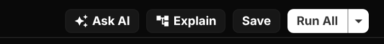

`results.statusbar` items are listed in the **Visualize** menu of the query results status bar. The button sits next to **Edit Data**, and is disabled while the result has no rows.

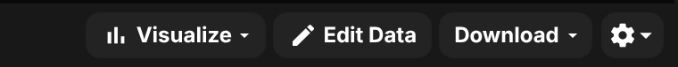

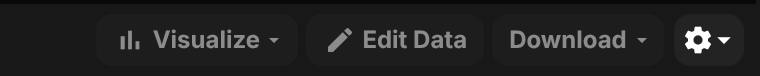

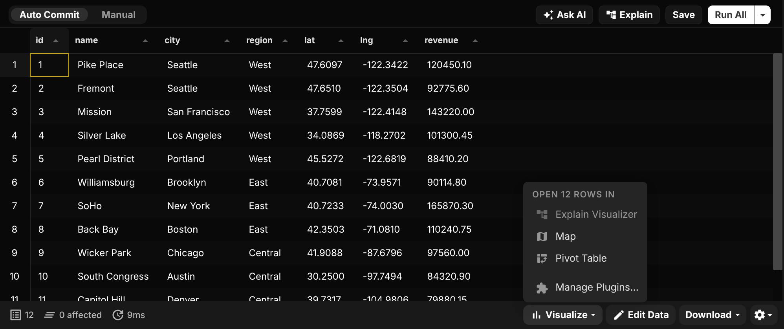

`tableTable.statusbar` items are listed in the **Visualize** menu of the table view.

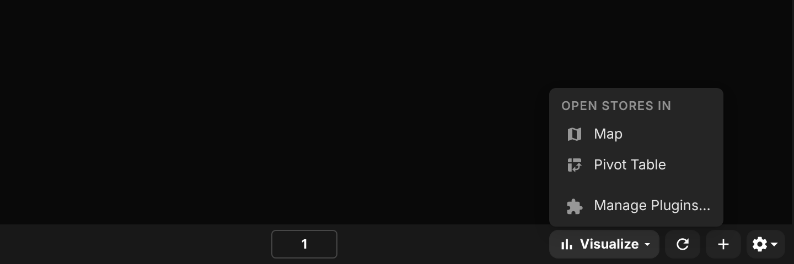

The `*.context` placements add items to the **Plugins** section of a context menu: here `editor.query.context`, `results.cell.context` and `entity.table.context`.

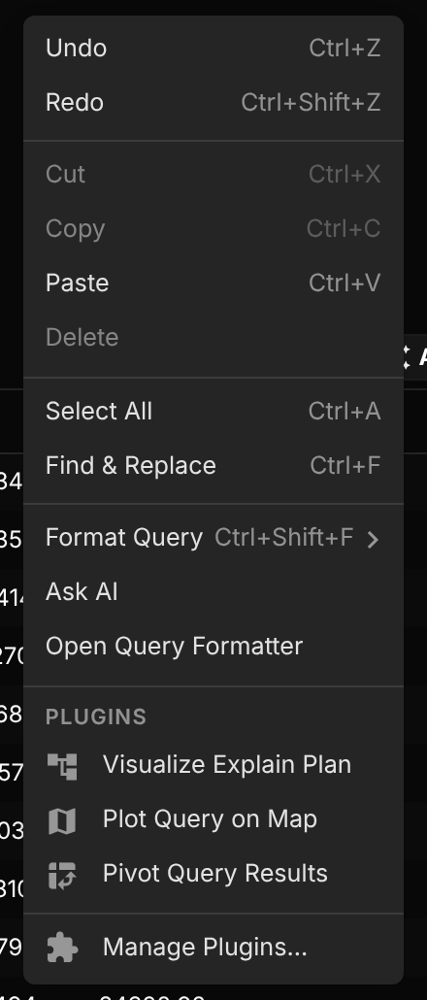

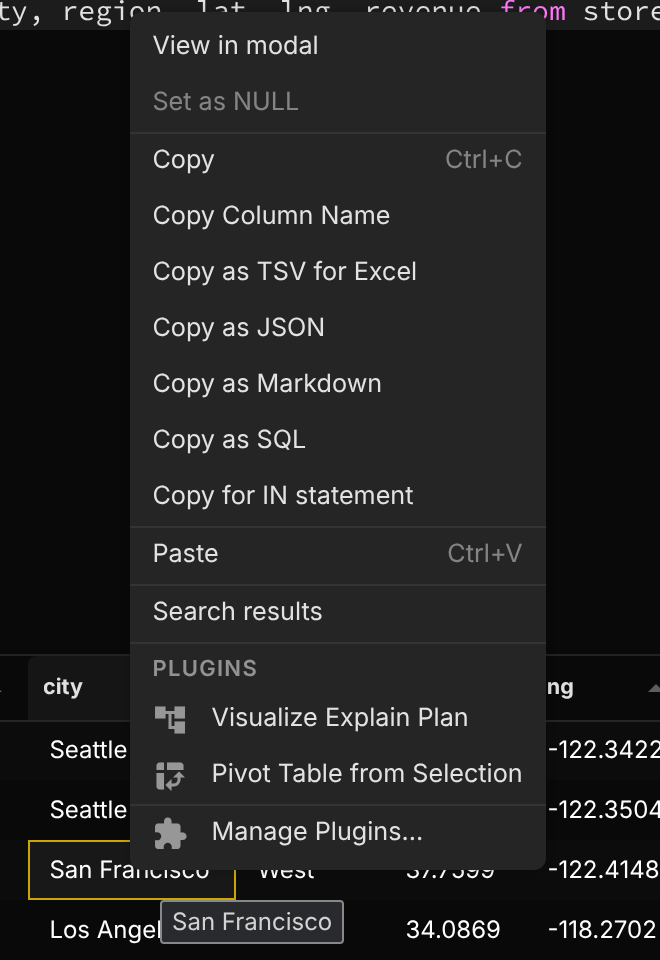

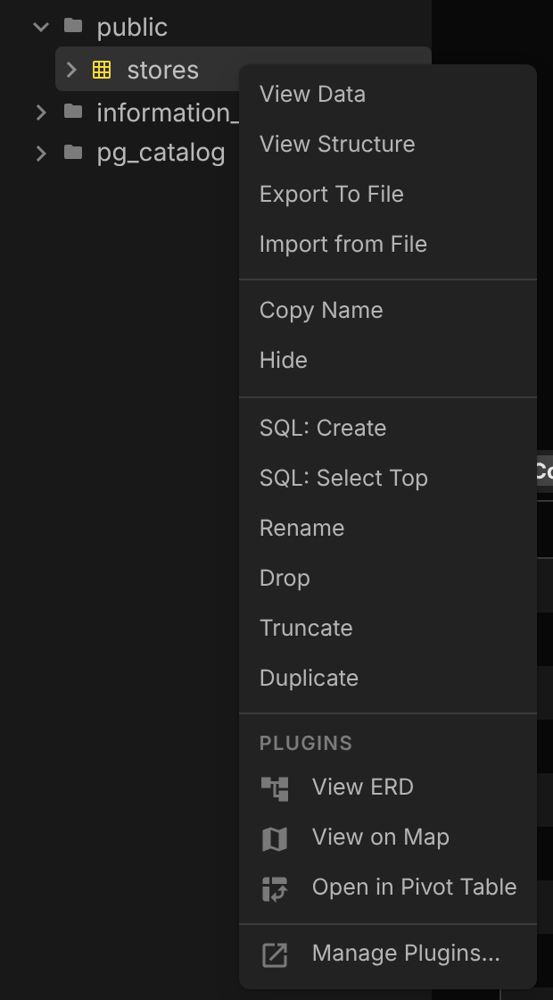

`newTabDropdown` items are listed in the dropdown next to the new tab button.

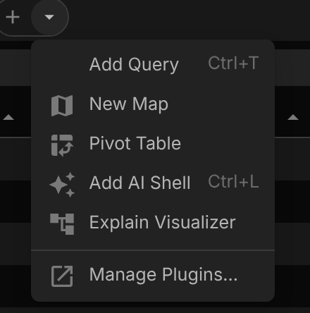

#### When no plugin uses a placement

Nothing is added: no toolbar buttons, no **Visualize** button and no **Plugins** section, so the app looks as it does without plugins. The new tab dropdown still ends with **Manage Plugins…**.

| Placement | With a plugin | Without plugins |
| --------- | ------------- | --------------- |
| `editor.query.toolbar` |  | 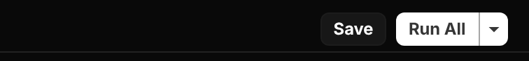 |
| `results.statusbar` |  | 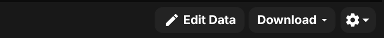 |
| `tableTable.statusbar` | 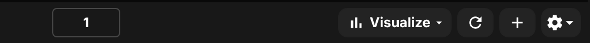 | 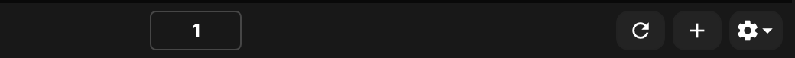 |
| `editor.query.context` |  | 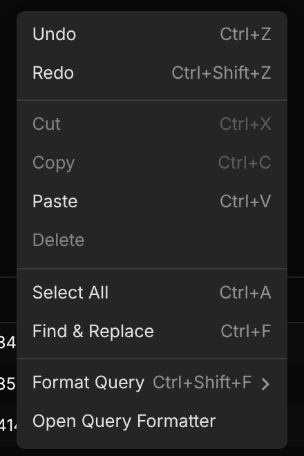 |
| `results.cell.context` |  | 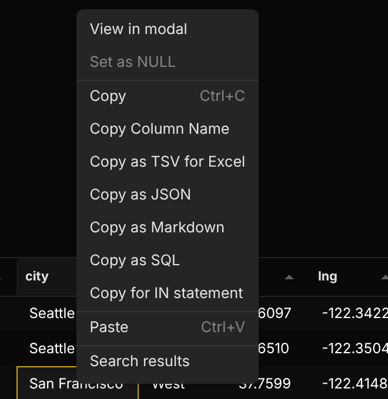 |
| `entity.table.context` |  | 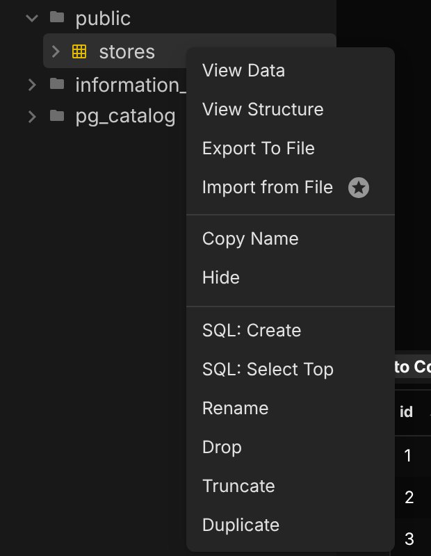 |
| `newTabDropdown` |  | 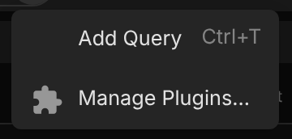 |

### PluginMenuItemCondition

| Value             | Description                                                                                                                    |
| ----------------- | ------------------------------------------------------------------------------------------------------------------------------ |
| `"explainResult"` | The result came from an `EXPLAIN` statement, or has the columns of a query plan (such as `QUERY PLAN`). Reported by `results.statusbar`; always false in `tableTable.statusbar`. |

An item waiting on `explainResult` is disabled in the **Visualize** menu until the result is a query plan:

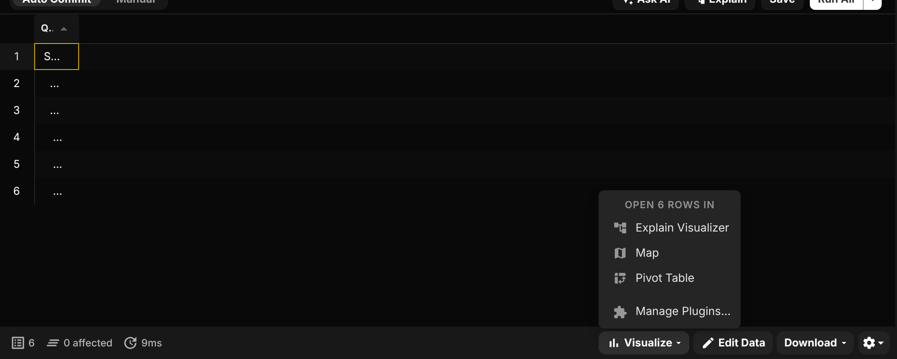

### Menu item params

When a menu item is picked, the new tab can read how it was opened with [`getViewContext()`](api-reference.md#getviewcontext). `params` depends on the placement:

| Placement                                                  | `params`                                                                     |
| ---------------------------------------------------------- | ---------------------------------------------------------------------------- |
| `newTabDropdown`, `menubar.tools`                          | None                                                                         |
| `editor.query.context`, `editor.query.toolbar`             | [`EditorMenuParams`](api-reference.md#editormenuparams)                      |
| `results.*.context`, `tableTable.*.context`                | [`CellMenuParams`](api-reference.md#cellmenuparams), [`ColumnMenuParams`](api-reference.md#columnmenuparams), [`RowMenuParams`](api-reference.md#rowmenuparams) or [`CornerMenuParams`](api-reference.md#cornermenuparams) |
| `results.statusbar`, `tableTable.statusbar`                | [`StatusbarMenuParams`](api-reference.md#statusbarmenuparams)                |
| `tab.query.header.context`, `tab.table.header.context`     | [`TabMenuParams`](api-reference.md#tabmenuparams)                            |
| `entity.*.context`, `structure.statusbar.menu`             | [`EntityMenuParams`](api-reference.md#entitymenuparams)                      |

#### Status bar params

The **Visualize** menu sends what the user is looking at, and `source` says which:

- `"selection"`: the user selected more than one cell. `activeRange` holds the selection, and the menu heading counts cells instead of rows.
- `"result"`: nothing is selected in a query result. `activeRange` holds every row of the result. `truncated` is true when the result stopped at the row limit, and `query` is the statement that produced it, so you can run it again for more rows.
- `"table"`: nothing is selected in a table view. The grid only holds one page of the table, so no rows are sent. Read the table yourself from `entity`, applying `where` (the SQL condition for the filters in the table view), with a row limit that suits your plugin.

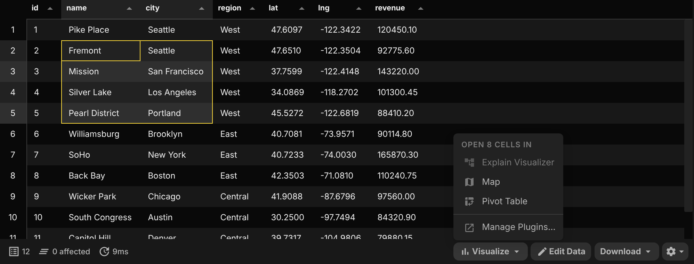

```json
{
  "command": "pivot-results",
  "name": "Pivot Table",
  "view": "pivot-view",
  "placement": ["results.statusbar", "tableTable.statusbar"],
  "icon": "pivot_table_chart"
}
```

## Legacy Format (Manifest V0)

The old `tabTypes` format looks like this:

```json
{
    "manifestVersion": 0,
    "capabilities": {
        "views": {
            "tabTypes": [
                {
                    "id": "data-visualizer",
                    "name": "Data Visualizer",
                    "kind": "shell",
                    "entry": "tab.html"
                }
            ]
        }
    }
}
```

Please use the new `capabilities` format instead.
